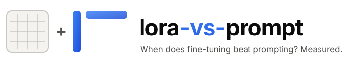
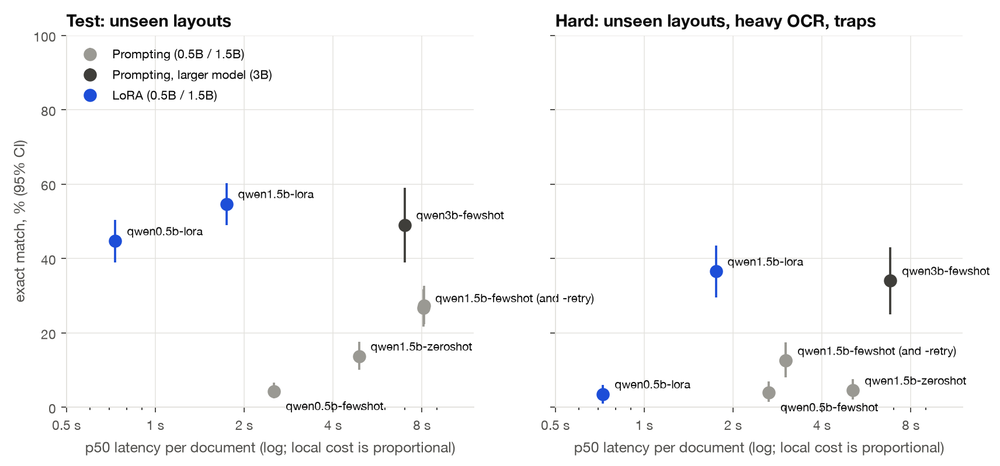
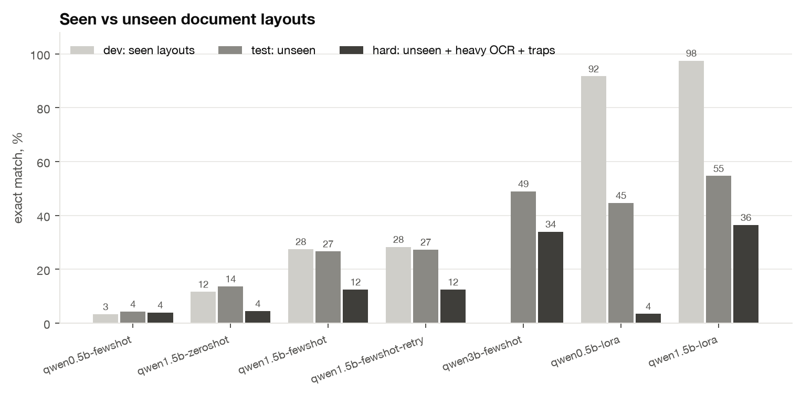
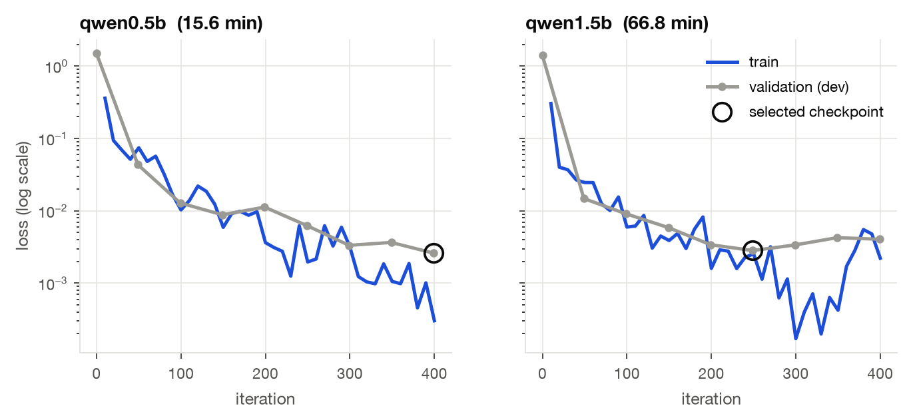
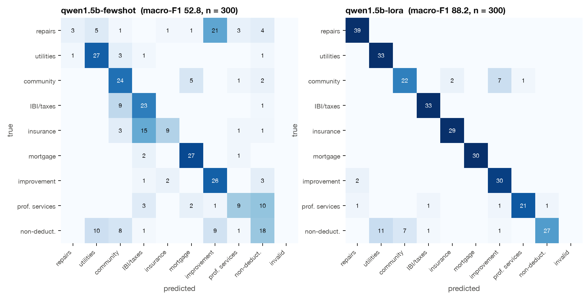

<p align="center">
  <picture>
    <source media="(prefers-color-scheme: dark)" srcset="docs/assets/logo-dark.svg">
    
  </picture>
</p>

<p align="center">
  A reproducible, fully local study of when a LoRA adapter on a small model beats prompting,
  measured on Spanish rental-property expense documents.
</p>

---

**The task.** Read an invoice, utility bill, homeowners' association receipt, IBI notice,
insurance receipt or loan statement for a rented flat in Spain. Return one JSON object with the
tax category (9 classes) and eight fields: vendor, date, base, VAT, total, billing period, and
whether the cost is recharged to the tenant. Everything runs on a 16 GB MacBook Air (M4) with
[mlx-lm](https://github.com/ml-explore/mlx-lm) and 4-bit Qwen2.5 models. No API keys.

**The short answer.**
- A LoRA adapter on Qwen2.5-1.5B is the best category classifier by a wide margin. It is also
  4x faster than the prompts it replaces.
- On full extraction it is only level with a twice-as-large model prompted with examples.
- It memorises the training templates: 97.5% exact match on seen layouts, 54.7% on unseen
  ones, 36.5% on unseen layouts with heavy OCR noise.
- Fine-tune when the label set is stable and latency or volume matters, and only with
  training documents that look like production.

## Results

Exact match means the category and all nine fields are right. That is the rate at which a
bookkeeping pipeline would not need a human. Brackets are 95% bootstrap intervals. Full tables,
including per-field accuracy and per-trap slices, are in [`results/results.md`](results/results.md).

**Test set**: 300 documents. The layouts, vendors and wording do not appear in training.

| Contender | Exact match | Category macro-F1 | JSON valid | p50 latency | Prompt tokens | Peak memory |
|---|---|---|---|---|---|---|
| Qwen2.5-0.5B, 4 examples | 4.3 [2.3, 6.7] | 10.3 | 93.0 | 2.53 s | 1,626 | 0.99 GB |
| Qwen2.5-1.5B, zero-shot | 13.7 [10.0, 17.7] | 45.3 | 60.7 | 4.90 s | 638 | 1.56 GB |
| Qwen2.5-1.5B, 4 examples | 26.7 [21.7, 31.7] | 52.8 | 98.3 | 8.11 s | 1,626 | 1.52 GB |
| Qwen2.5-1.5B, 4 examples + 1 retry on invalid JSON | 27.3 [22.3, 32.7] | 52.8 | 99.7 | 8.15 s | 1,656 | 1.57 GB |
| Qwen2.5-3B, 4 examples (n = 100) | 49.0 [39.0, 59.0] | 69.8 | 100.0 | 6.99 s | 1,626 | 2.50 GB |
| **Qwen2.5-0.5B + LoRA** | 44.7 [39.0, 50.3] | **89.9** | 97.7 | **0.73 s** | 172 | **0.57 GB** |
| **Qwen2.5-1.5B + LoRA** | **54.7** [49.0, 60.3] | 88.2 | **100.0** | 1.74 s | 172 | 1.37 GB |

**Hard set**: 200 documents. Two more unseen layouts (an online-banking CSV export and an
abbreviated scanned receipt), heavy OCR noise on every document, and every trap over-sampled.

| Contender | Exact match | Category macro-F1 | JSON valid | p50 latency |
|---|---|---|---|---|
| Qwen2.5-0.5B, 4 examples | 4.0 [1.5, 7.0] | 5.7 | 91.5 | 2.65 s |
| Qwen2.5-1.5B, zero-shot | 4.5 [2.0, 7.5] | 26.7 | 44.0 | 5.10 s |
| Qwen2.5-1.5B, 4 examples (and + retry: identical) | 12.5 [8.0, 17.5] | 30.9 | 100.0 | 3.02 s |
| Qwen2.5-3B, 4 examples (n = 100) | 34.0 [25.0, 43.0] | 49.3 | 100.0 | 6.82 s |
| Qwen2.5-0.5B + LoRA | 3.5 [1.0, 6.0] | 69.7 | 96.5 | 0.73 s |
| **Qwen2.5-1.5B + LoRA** | **36.5** [29.5, 43.5] | **84.0** | 98.5 | 1.75 s |

The 3B model was scored on a seeded, category-stratified subsample of 100 documents per split
to save compute, so its intervals are wider.

**Paired differences.** These are computed on the same documents for both sides, with a paired
bootstrap, in percentage points:

| | Split | Exact match | Category accuracy |
|---|---|---|---|
| 1.5B LoRA minus 1.5B with 4 examples | test | +28.0 [+21.3, +35.0] | +32.7 [+26.7, +38.7] |
| 1.5B LoRA minus 1.5B with 4 examples | hard | +24.0 [+15.5, +32.5] | +51.5 [+43.5, +59.0] |
| 1.5B LoRA minus 3B with 4 examples | test (n = 100) | +7.0 [-5.0, +18.0] | +19.0 [+11.0, +28.0] |
| 1.5B LoRA minus 3B with 4 examples | hard (n = 100) | +10.0 [-3.0, +23.0] | +35.0 [+25.0, +45.0] |
| 0.5B LoRA minus 0.5B with 4 examples | hard | -0.5 [-4.5, +3.5] | +57.5 [+49.5, +65.5] |

<picture>
  <source media="(prefers-color-scheme: dark)" srcset="docs/figures/quality-vs-latency-dark.png">
  
</picture>

### Seen vs unseen layouts

The dev split is new documents rendered from the training layouts, vendors and wording. Test
and hard share none of them with training. Prompting scores the same on dev and test. LoRA
loses 43 to 47 points.

<picture>
  <source media="(prefers-color-scheme: dark)" srcset="docs/figures/seen-vs-unseen-dark.png">
  
</picture>

### Training

The two adapters share the same settings:
- rank 8, scale 20, dropout 0.05 on the last 16 layers;
- Adam at 1e-4, batch 4, 400 iterations, which is 2 epochs over 800 documents;
- loss on the answer only, with gradient checkpointing.

A checkpoint is saved every 50 iterations and the one with the lowest dev loss is kept: 400
for the 0.5B and 250 for the 1.5B, whose dev loss rises after that point.

Training loss ends near 0.001. That is expected: the answer is a short JSON object mostly copied
from the input. But it says nothing about generalisation, and the test and hard numbers above
are the evidence of that.

| Adapter | Train time | Peak memory | Selected checkpoint (dev loss) | Adapter size |
|---|---|---|---|---|
| Qwen2.5-0.5B | 15.6 min | 2.14 GB | 400 (0.0026) | 11.8 MB |
| Qwen2.5-1.5B | 66.8 min | 2.79 GB | 250 (0.0028) | 21.1 MB |

<picture>
  <source media="(prefers-color-scheme: dark)" srcset="docs/figures/loss-curves-dark.png">
  
</picture>

### Where the errors are

The comparison below is the same 1.5B model on the same 300 test documents.
- The prompted model mixes up categories everywhere: repairs become improvements, insurance
  becomes IBI, professional services become non-deductible.
- The adapter's remaining confusion is concentrated in two places. Non-deductible documents
  are read as utilities or community fees: this is the owner's-home trap, where the bills look
  deductible and are not. And some community fees are read as improvements.

<picture>
  <source media="(prefers-color-scheme: dark)" srcset="docs/figures/confusion-dark.png">
  
</picture>

## Conclusion

**Where LoRA wins**
- **Classification into a fixed label set.** Category macro-F1 is 88 on test and 84 on hard
  for the 1.5B adapter. The same model prompted with examples scores 53 and 31, and a 3B model
  scores 70 and 49. Both paired intervals exclude zero.
- **Format.** The adapter never needed the 1,450-token guide to produce valid JSON (100% on
  test).
- **Speed.** A 172-token prompt instead of 1,626 makes it 4x faster than the 3B model and
  4.7x faster than the prompt it replaces: 0.48 machine-hours per 1,000 documents instead of
  1.95 and 2.23.

**Where it does not win**
- **Full extraction against a larger prompted model.** The 1.5B adapter is ahead of the 3B
  model by 7 to 10 points of exact match, but the paired intervals include zero. You can get
  similar extraction quality without training anything, at about 4x the latency.
- **A smaller base model.** The 0.5B adapter looks excellent on dev (91.7%), decent on test
  (44.7%) and collapses on the hard set (3.5%). It learned the templates, not the task.
- **Vendor names it has never seen.** The adapters rewrite them towards the training
  vocabulary, for example "Aguas Municipales S.A." for "Canal de Aguas Municipal S.A.". Vendor
  accuracy on hard is 63.5% for the 1.5B adapter against 96.5% for the same model prompted.

**Break-even.**
- **Compute is not the cost.** Training the 1.5B adapter used about 0.02 kWh, under one euro
  cent at an assumed 20 W draw.
- **The labels are.** 800 documents at 45 s each and 25 EUR/h cost 250 EUR.
- **Against local prompting,** the per-document saving is a fraction of a cent, so that money
  is never repaid. The reason to fine-tune locally is latency and category accuracy, not cost.
- **Against a hosted API,** using list prices for gpt-4o-mini (0.15 / 0.60 USD per million
  tokens) applied to the zero-shot prompt, labelling is repaid after about 1.7 million
  documents. The API's accuracy on this task was not measured, because the study uses no paid
  keys.
- The arithmetic is in `results/results.md` and [`src/lora_vs_prompt/report.py`](src/lora_vs_prompt/report.py).

**Risks**
- **Template overfitting.** This is the main risk. Evaluating an adapter on held-out documents
  from the training templates overstates it by about 40 points here. Hold out whole layouts,
  vendors and wording, as this repo does, and check n-gram overlap.
- **Drift.** A new bank export format or a new utility company is out of distribution for the
  adapter in a way it is not for a prompted model. The hard set shows what that costs.
- **Retraining is part of the cost.** Retraining on drift means labelling again. Keep a
  regression gate on a golden set, described below, so a new adapter cannot silently break
  cases the old one got right.

**Fine-tune when** all of these hold:
- the label set is closed and stable;
- you can label a few hundred documents that look like production;
- latency or volume matters;
- you will maintain a held-out set of layouts.

**Prompt a larger model when** documents vary a lot, new vendors appear all the time, or the
volume does not justify the labelling.

## Methodology

[`docs/methodology.md`](docs/methodology.md) covers:
- the schema and category definitions;
- how the data generator avoids leakage (disjoint pools of layouts, vendors and wording, and a
  measured 6-gram overlap with train of 24.9% for dev, 1.8% for test and 0.9% for hard);
- every trap in the hard split;
- the scoring and normalisation rules;
- how latency, memory and cost are measured.

In brief:
- **Data.** Synthetic, seeded, Spanish. The label is sampled first and then rendered, with
  per-document date and amount formats, OCR noise, prompt-injection lines, distractor amounts,
  IRPF withholding and owner's-home lookalikes.
- **Contenders.** Greedy decoding, `max_tokens=200`, batch size 1, one model in memory at a
  time.
- **Scoring.** Normalised fields: amounts within one cent, dates in any common format, and a
  vendor match tolerant to OCR noise. Macro-F1 with invalid output counted as a wrong class.
  Bootstrap intervals with 2,000 resamples.

## Limitations

- **Synthetic data.** Real documents are messier in ways a generator does not anticipate, and
  the tax rules are simplified on purpose. The numbers compare methods; they are not a product
  benchmark.
- **One training seed per adapter.** Variance across training runs is not measured.
- **Subsampled 3B reference.** The 3B model was scored on 100 documents per split.
- **Estimated energy.** The power draw is assumed (20 W), not measured: `powermetrics` needs
  root. Hosted-API costs are list prices applied to token counts from the Qwen tokenizer.
- **Fanless machine.** The MacBook Air is fanless and throttles on long runs. The same 1.5B
  few-shot prompt ran at 39 tokens/s on test and 86 tokens/s on hard, because the two splits
  ran in different thermal states days apart. Latencies are indicative to within about 2x.
  The ordering of the LoRA (short prompt) and few-shot (long prompt) contenders does not
  depend on it.
- **Metric changed after first scoring.** The vendor tolerance was added after the first
  scoring pass. It applies to every contender, and the strict-match numbers are given in the
  methodology.

## Reproduce on Apple Silicon

Requirements:
- an Apple Silicon Mac with 16 GB of memory;
- [uv](https://docs.astral.sh/uv/);
- about 3 GB of disk for the three models, which download from Hugging Face on first use.

```bash
make setup    # uv sync: Python 3.12, mlx-lm 0.32, numpy, pydantic, matplotlib, typer
make data     # data/{train,dev,test,hard}.jsonl, data/stats.json (seed 13, byte-identical)
make train    # both adapters into adapters/ (about 15 and 67 minutes on an M4)
make eval     # predictions/ (cached per document) and results/metrics.json
make report   # results/results.md, docs/figures/*.png, export/evalsmith/
make test     # 39 tests: generator, leakage, metrics, prompts, export
```

Predictions are committed. On a fresh clone without adapters, `make eval report` rebuilds every
number and figure from the cache in seconds. Delete `predictions/<contender>/` to rerun one
contender; a cache whose prompt, model or adapter changed is discarded automatically.

Generating everything from scratch takes about 3.5 hours of inference plus 1.4 hours of
training on an M4.

To share the machine with other jobs that load models, set `COMPUTE_LOCK=/path/to/lockdir`.
Every model-loading step then waits for that directory lock.

**Adapters** are not in git. Rebuild them with `make train`, which is deterministic for a given
seed and mlx version. The 0.5B adapter (11.8 MB) is small enough to attach to a release as
`adapters/qwen0.5b/adapters.safetensors`. The 1.5B adapter (21.1 MB) is meant to be rebuilt.

## Gating prompt and adapter changes with evalsmith

`make report` writes the test set as a golden set for
[evalsmith](https://github.com/diegoperezg7/evalsmith-mcp):
- `golden.json`: every field pinned with a `json_schema` check, plus a `contains` check for the
  vendor;
- one outputs file per contender;
- `evalsmith.yaml`: uses the 1.5B adapter as the baseline, with a pass-rate gate set 5 points
  under its current rate.

To gate a change, write its outputs as `{id: output}` to `export/evalsmith/outputs/`, point
`candidate` at the file and run:

```bash
evalsmith run export/evalsmith/evalsmith.yaml
```

The run exits non-zero when the pass rate drops under the gate, or when any case that passed on
the baseline now fails. Swapping in the few-shot prompt as baseline shows why the second rule
matters. The adapter fixes 105 test cases, but breaks 32 that the prompt got right.

## Layout

```
src/lora_vs_prompt/   data.py (generator) · prompts.py · train.py · inference.py · metrics.py
                      evaluate.py · report.py · export.py · cli.py (lvp data|train|eval|report)
data/                 generated splits and stats
predictions/          one JSONL per contender and split, plus run metadata
results/              metrics.json and results.md
docs/                 methodology, figures, logo
export/evalsmith/     golden set, outputs, suite config
```

## License

Proprietary. See [LICENSE](LICENSE).
